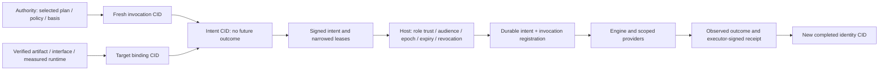
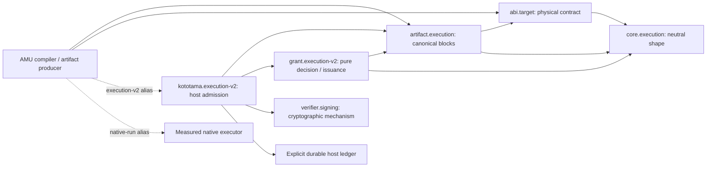

# Target v2 issuance and admission

The neutral contract has 17 exports and zero source imports. ABI defines closed
bindings for 23 AMU CLI target profiles, with distinct native calling conventions
and context versions, Wasm/Component layout, Script bridges and bounded EVM ABI.
Each family declares its own meters; native/Script/EVM budgets are not Wasm pages.
The vocabulary is broader than the qualified host mechanisms.

`grant.execution-v2` derives policy decisions with the existing broker, narrows
explicit authority-owned ceilings and issues canonical invocation/lease blocks.
The authority must resolve immutable plan/policy/basis/grants/approvals and fresh
256-bit invocation entropy from its own fact store. A guest-selected permit,
nonce, signer, permission ceiling, provider or basis never authorizes execution.

## Issuance, execution and completion

An intent contains `invocation-cid`, omits outcome/receipt fields and never mutates.
The lease's existing `execution-identity-cid` names that pre-execution intent.
Completion retains the existing v2 identity fields and binds the intent through
signed receipt CIDs. A new execution at the same basis gets a new invocation;
replay and a second intent using an already registered invocation are denied.

Metadata is bounded canonical DAG-CBOR with typed values and explicit CID links.
Hosts rehash and check canonical encoding before decoding; flags such as
`verified:true` never count as evidence. Large Script artifacts use the existing raw
content-block owner, not a truncated hash or JSON/EDN rendering of v2 descriptors.
The current native adapter refuses sealed-envelope metadata beyond the 64 KiB
block bound; larger native envelopes require a separate raw-block binding gate.
Legacy native seal bytes retain their existing canonical encoding/hash domain.

Authority and executor keys have separate trust sets. Admission checks the
actual artifact/profile/interface/runtime/input binding and the authority's
signed audience/window/epoch. Every provider call refreshes expiry, epoch and
revocation (including referenced policy/grant/binding CIDs), then atomically
consumes a use before calling the scoped provider. Traps do not refund uses.
Run completion closes its provider closures. Async execution requires a bounded
poll/cancel host; the synchronous runner refuses it.

## Responsibilities and actual library edges

These edges are consumer to dependency; runtime alias edges are dashed.
They do not change the language/VM/protocol ownership DAG.

Grant imports content codecs, not an engine or OS. The import-free neutral
namespace does not acquire artifact, crypto, filesystem or consensus dependencies.
AMU runtime composition is an explicit alias; compiler production pins and its
regenerated lock remain separate from the stdlib nbb bootstrap.

## Evidence and activation boundary

| Profile | V2 path and evidence | Remaining boundary |
|---|---|---|
| All 23 declared profiles | Closed binding/CID contracts and authenticated admission fixtures | Fixture coverage does not qualify a physical host |
| aarch64 macOS native | AMU JVM-free generated artifact, reproduced/measured loader, execution result 42, signed completion | Pure zero-argument i64 with explicit fuel; effectful native provider wiring denied |
| Wasm core on Node | Checked source re-emission, actual WebAssembly execution, typed i64 result 42 | Browser/WASI host mechanisms need their own acceptance |
| restricted Script on Node | Checked source re-emission, restricted output verification, bounded child execution, result 42 | Pure zero-argument i64; browser/CLJS and effect bridge are not enabled |
| bounded EVM | Verified bytecode re-emission and actual VM execution, result 42 | Pure ABI subset; no mainnet state, calls, gas equality or settlement claim |
| Component v1 profile | Separate v2 byte/WIT/world admission and link; real Wasmtime fixture result 42 with WASI CLI disabled; world widening refused | Fixture is not AMU whole-project or effectful Component qualification |

The Node ledger uses a private, explicit 0700 storage directory, an atomic
inter-process lock, fsynced temporary journal, rename and directory fsync.
It persists consumed uses, invocation/intent registration, monotone epoch and
clock floor. Corrupt journals, abandoned locks, clock rollback and stale epochs
fail closed. Recovery requires operator review; it never resets the journal.
It has no privileged disk rollback or consensus guarantee.

## Distributed domains

A CID identifies immutable content; IPFS/IPLD retrieval and DHT replication do
not authorize effects. Holochain-inspired integrity and causal histories remain
separate from ordered policy/shared-asset/shared-head finality and EVM settlement.
An audience names one admission domain backed by a shared atomic ledger. Different
hosts cannot independently consume a lease intended as a global quota. Placement
selects/fences a host; it does not issue grants. Cross-domain movement requires new
authority issuance and the domain's required finality/fencing proof. If policy
requires ordered finality, its issuer must select a finalized basis through the
existing authority/inga owner; local journaling or causal replication cannot
substitute for it. This unit adds no consensus implementation.

V1 defaults, wire bytes, WIT, CIDs and signatures remain compatible. No pin
update implicitly activates v2. Q9 remains a whole-component native Kotoba
source migration with its own acceptance, separate from this explicit CLJK unit.

## Repeatable acceptance

Kototama runs `scripts/test-execution-v2.cljk` (7 tests, 170 assertions) and `scripts/test-component-v2.cljk` with explicitly selected Wasmtime/wasm-tools. AMU runs `scripts/test-execution-v2-targets.cljk` and `scripts/test-execution-v2-native.cljk` from its generated `execution-v2` / `native-run` lock aliases. The native gate includes an unmetered control that must be denied. ABI/core foundation coverage is 9 tests / 707 assertions; canonical blocks are 4 / 276; grant issuance is 2 / 12; the EVM owner suite is 56 / 193. Existing artifact coverage is 20 / 102 and Component v1 is 6 / 27.

CI and physical evidence are recorded separately. The new AMU v2 job must execute on the pinned Node/engine and lock; a setup failure, missing package, stale lock, zero-test run or unstarted job is not a pass. Native sealed integers are normalized only after artifact verification; v1 metered flag omission retains its defined meaning and `off` remains refused.
