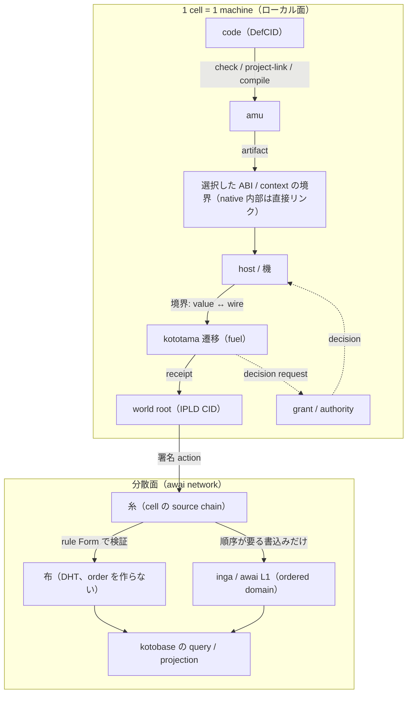

# Kotoba Lisp machine 統合設計 — Holochain / EVM / awai を参照した分散 Lisp machine

Status: **提案（:proposed）** · 2026-10-21。責務と構造の設計提案であり、実装移行・
qualification・広告可能な完成のいずれも意味しない。証拠のない箇所には「未実装」または
「:proposed」と書く。**文書の変更だけを実装移行と数えない。**

名前は owner 確定（2026-10-21）: **Kotoba Lisp machine**。描写的な名を採用し、metaphor 名
（kumiori / orimono 等の候補）は使わない。「kotoba marshal」という名は誤入力であり、
この設計の名でも契約の名でもない。

正本関係は [authority-map.edn](authority-map.edn) に従う。責務の凡例は
[stack-architecture.md](stack-architecture.md)、VM の正本は
[kototama-vm-v1.edn](https://github.com/kotoba-lang/kototama/blob/main/spec/kototama-vm-v1.edn)、
分散の既定構成は [stack-architecture-target-neutral.ja.md](stack-architecture-target-neutral.ja.md)、
agent-centric な面は root の ADR-2610082200、順序 domain は inga（ADR-2608038000）、
chain は awai L1 charter（ADR-2610092330）。**この文書はそれらを書き換えず、
「Lisp machine としての全体」と「境界の形」だけを足す。**

機械可読の草案: [kotoba-lisp-machine-boundary.draft.edn](kotoba-lisp-machine-boundary.draft.edn)（:status :proposed）。

## 0. 何を足すのか

`stack-architecture.md` は「現代の Lisp machine を目指す」という構成の物語と、次の 6 つが
**証拠として存在しない**ことを宣言している: 統合 REPL / editor / debugger、稼働中システムの
任意の live 変更、heap / 継続を含む image 保存と復元、selfhost、C-free 本番経路、実機
qualification。

この文書はそのうち**設計が無い 3 つ**（image・対話環境・分散 Lisp machine）に設計を置き、
同時に今まで seam ごとに散らばっていた境界符号化を **境界の形（boundary encoding）** 1 つの契約に束ねる。
これは構成の設計であって、上記 6 つの証拠を 1 つも作らない。

## 1. 用語の固定

このマシンの部品の名前をここで固定する。正本がある語はそこを指すだけで、再定義しない。

| 名前 | 意味 | 正本 |
|---|---|---|
| 値 value | 不変・永続・構造等価の値 | kototama `:values` |
| コード code | checked code の identity（DefCID） | kototama `:program` / `lang/typed-eval.edn` |
| 遷移 transition | fuel 付きの決定的 1 ステップ | kototama `:transition` |
| 世界 world | IPLD の state root（CID） | kototama `:state :world-root` |
| 記録 receipt | 実行の署名付き記録 | kototama `:receipt` |
| **image** | 世界 × コード環境 × 開いた lease の組 | **この文書 §5.1（提案）** |
| **境界の形 boundary** | 判断を持たない境界符号化 | **この文書 §4（提案）** |
| 機 conductor / 紋 DNA / cell / 糸 ito / 布 nuno / membrane / kotoba app | agent-centric な面の部品 | root ADR-2610082200 |
| 順序 domain / inga / awai L1 | 順序と finality が要る書書き込みの裁定 | ADR-2608038000 / ADR-2610092330 |
| 層 T0–T6 / L0–L5 / 通信 8 面 | 責務・データ・通信の凡例 | root `manifest/kotoba-stack-legend.edn`（この文書は番号を足さない） |

## 2. 参照する 3 系譜 — 借りるもの、借りないもの

**規則: 言語意味・VM 遷移を 3 系譜のいずれからも導出しない。** これは
target-neutral 文書が Wasm / WIT に対して立てた線と同じである。借りるのは構造の
アイデアだけである。

### 2.1 Holochain から借りるもの

| Holochain | Kotoba での対応 | 状態 |
|---|---|---|
| integrity zome / coordinator zome の分離 | rule Form / logic Form | ADR-2610082200 §4 |
| DNA / Cell | 紋 mon（網の定義）/ Cell（mon CID × agent 公開鍵） | abi `spec/mon-v1.edn` / hata.cell |
| source chain（自分の action は自分でしか書けない） | 糸（cell ごとの署名付き action の連鎖） | ADR-2610082200 §5 |
| validation が合意である（global order を作らない） | 合意の既定 | ADR-2610082200 §6 |
| DHT を DNA で keyspace 分割 | 布（紋 CID で区切った Kademlia keyspace） | ADR-2610082200 §5 |
| membrane（入会条件） | cell の genesis で検査する証明 | ADR-2610082200 |
| conductor / hApp | 機 / kotoba app | ADR-2610082200 §2 §7 |

借りない: zome の wasm API そのもの、DHT を共有 store として扱うこと、
「validation 成功 = 全体の順序確定」にすること（target-neutral が禁止）。

### 2.2 EVM から借りるもの

| EVM | Kotoba での対応 | 状態 |
|---|---|---|
| 決定的な状態遷移と metering | kototama `:transition` と fuel（gas とは別単位） | kototama spec（既存） |
| receipt | `:receipt`（state-before/after、fuel-used、events、child receipts） | kototama spec（既存） |
| chain id / genesis | message の `:chain-id` | kototama spec（既存） |
| 外部 chain への settlement | settlement adapter（read + verify。署名・broadcast は etzhayyim 専権） | target-neutral |
| 互換 profile としての EVM | `:evm/v1` `:fevm/v1`（core ではない） | kototama `:profiles` |

借りない: 全体 state trie を言語意味にすること、account model、
「fuel = gas = 課金 credit」の同一視（kototama の compatibility 節が禁止）。

### 2.3 awai から借りるもの

| awai | Kotoba での対応 | 状態 |
|---|---|---|
| 順序と finality が要る書込みだけを受ける ordered domain | inga の 2f+1 QC、state root は prolly tree の root CID | ADR-2608038000 |
| 名乗りの段階 S0〜S4 | ゲートを測って通すまで対外語を制限する運用 | ADR-2610092330 D3 |
| D1 / DO / KV を状態置き場にしない | awai 系の状態は content-addressed object + quorum 証明書 | ADR-2609132007 |
| chain 名 awai と法人 AWAI Network, L.L.C. の書き分け | 対外文書で必ず区別する | ADR-2610092330 D9 |

借りない: トークン経済をマシン意味にすること（D4 は chain の話であって VM の話ではない）。

## 3. マシンの全体像

**1 machine = 1 Cell（= 紋 CID × agent 公開鍵の identity）。** 紋（mon）は DNA にあたる定義であり、
Cell という実行 instance ではない。node / process / container は配置であり Cell identity と分ける。
ネットワークは「1 つの巨大な共有 heap」では
なく、同じ code（DefCID）と contract を各自が検証して実行する machine の集まりである。
層の対応は root の凡例が正本。ここでは 2 つの面だけを描く。



- 値・コード・状態・記録はすべて content-addressed。実行は fuel 付き遷移、
  境界はすべて §4 の境界の形を通る。
- 合意の既定は validation。順序が要る書込みだけが ordered domain に入る（§6.1）。
- hosted 実行に AiueOS は必須ではない（stack-architecture.md の既存の線）。

## 4. 境界の形（boundary encoding）

### 4.1 定義

**境界の形は判断を持たない符号化である。** 以下この契約を「境界の形」と呼ぶ。pack / unpack / 長さ / 順序だけを扱い、
検査（valid か）も決定（許可されるか）も実行（走るか）もしない。

この原則は aiueos に既に実装されている規約の一般化である:

- aiueos: 「C marshals, Kotoba judges」—— kernel と object の間は flat record
  （base + length）で、layout の正本は `.kotoba` 側のヘッダ comment、判定はすべて Kotoba 側
  （`os/aiueos` AGENTS.md、ADR-0219、`:kotoba.error/kernel-region-provenance`）。
- amu: collection は boundary で marshal し、resource を足さない（amu ADR 0065 / 0068 /
  0070 / 0076）。`:string` marshal の回数は仕事量として測られる（`docs/lang-cosientist.md`）。
- kototama: 値は `:tagged-dag-cbor-vector` に正規化され、`:host-object false`。

### 4.2 5 つの境界（domain）

Native 内部は [実行領域の ADR](adr/ADR-native-execution-domains.md) に従う。
同じ値表現・実行 context・権限領域・資源 budget の閉じた呼出しでは通常の型付き呼出しを使う。
名前空間や役割が異なるだけでは符号化しない。下表の host ↔ guest は実際に ABI / context
を越える profile の境界であり、native の全関数呼出しに課すものではない。
admission、provider の権限強制、資源制限、cell・wire・永続化の境界は残す。

| domain | 通る物 | 現行の記述場所 | 境界の形 | 判断は誰か |
|---|---|---|---|---|
| kernel ↔ object | flat record | aiueos ADR-0219、`.kotoba` ヘッダ comment | base + length、offset read | Kotoba object / grant |
| host ↔ guest | typed import / export | amu Canonical ABI（0065/0068/0070/0076）、abi.component profile | lift / lower の layout | host admission / authority |
| value ↔ wire | 値 / message / receipt | kototama `:canonical-form` `:values` `:message` `:receipt` | tagged dag-cbor vector | なし（CID 検証は store / host） |
| cell ↔ cell / node ↔ node | action / op / remote call | ADR-2610082200（糸・布）、kotoba-protocol の planes | 署名 action + op | rule Form（validation）/ grant |
| domain ↔ domain | 順序付き書込み / settlement | inga（ADR-2608038000）、awai L1（ADR-2610092330）、EVM adapter | message + receipt | inga QC / 各 domain の規則 |

### 4.3 不変条件（:proposed）

1. **judgment-free。** 境界の形は述語・policy・capability 判定を含まない。含んだ時点で
   それは rule Form か grant の仕事に移す。aiueos の「C marshals, Kotoba judges」を
   全 domain に広げたものである。
2. **既知 shape のみ。** 未知の tag / shape / profile は fail closed で拒否して記録する
   （kototama の `:unknown-effect :deny`、`:missing-origin :deny` と同じ姿勢）。
   黙って読み飛ばさない。「飛ばした」と「合格した」を出力で区別する。
3. **canonical bytes → CID の順。** 書き込みは canonical bytes を作ってから CID を付ける
   （kototama `:state :write :canonical-bytes-before-cid`）。読み込みは CID 検証後に
   decode（`:read :verify-cid-before-decode`）。
4. **versioned、wire key は保持。** 境界の形の spec 自体を content-addressed にし、
   versioned migration まで既存の wire key / CID 規則を変えない（target-neutral の規則）。
5. **秘密を境界符号化に載せない。** raw bearer・秘密鍵・ambient host handle は禁止
   （kototama `:receipt :forbidden`）。discovery や receipt に secret / provider handle を
   載せない。private content は client-held key で暗号化する。
6. **host object 不透過、host 呼び出しは仕事量。** `:host-object false` を維持し、
   境界の形が host を呼ぶ回数は fuel / 仕事量に数える（amu `lang-cosientist.md` の
   `:string` marshal 計測がその見方）。

### 4.4 なぜ境界の形が「全体を整える」骨格か

いま 5 つの seam に 5 つの別物がある（4.2 の表の「現行の記述場所」列）。Lisp machine として
image・cell・chain をまたぐには、値・コード・状態・記録が同じ規則で通る必要がある。
境界の形を 1 契約にまとめると:

1. kernel object・guest・cell・node が同じ値の形を話す（§3 の図の M1 と value ↔ wire が同じ契約）。
2. image の保存と復元が「同じ境界の形で世界を CID に落とす」ことになる（§5.1）。
3. 分散が「同じ code を別の machine で検証して実行すること」に落ち着く（§6.2）。

### 4.5 正本の置き場（決定: [ADR-kotoba-lisp-machine-contract-decisions.md](adr/ADR-kotoba-lisp-machine-contract-decisions.md) D1）

**新規 repo は作らない。** target-neutral の方針（独立 consumer と release 境界の確認まで
新規 repo / 一括改名をしない）に従う。置き案:

| 役割 | 置き案 |
|---|---|
| 中立の descriptor（shape の定義） | `kotoba-core-contracts`（`kotoba.core.execution` の隣） |
| target profile ごとの layout | `abi`（Component profile は既存の Canonical ABI と連続） |
| wire codec（bytes の正規化） | `kotoba-protocol` |
| kernel profile の実装 | aiueos の packer（現行 flat record を kernel 境界の実装と位置づける） |
| host / guest の実装 | amu の lower / lift |

## 5. Lisp machine の核 — image・対話・live（設計案）

### 5.1 image

このマシンの image は **raw heap の dump ではない**（`stack-architecture.md` の
「A Codebase commit is not a running heap image」を壊さない）。image は次の組である:

```
image = { world root (IPLD CID)
        × code environment (DefCID の束縛、明示的)
        × open leases / receipts の連鎖 }
```

- **保存** = 3 つを境界符号化して 1 つの CID に落とす。**復元** = CID から解決し、
  未解決の依存があれば unresolved として拒否する（ADR-2610082200 の
  valid / invalid / unresolved の姿勢）。
- 継続は値である（kototama `:explicit-continuations`）。image に含まれるのは
  開いている継続の**値**であり、GC に晒される隠れ参照ではない。
- これは「heap / 継続を含む image 保存と復元」の**設計**を与えるが、実装と
  conformance vectors は未実装。主張に使うときは owner の artifact と receipt を伴う。

:proposed・未実装。

### 5.2 対話環境（REPL / editor / debugger）

- **REPL** = typed eval の上の対話ループ。`eval` は DefCID で checked code を選び、
  AdmissionCID が interface・effect・allowance・limit を束縛する（`lang/typed-eval.edn`）。
  host-eval と reflection は無い（kototama `:host-eval false :reflection false`）。
  対話は「新しい DefCID を環境に束縛する操作」であって、機械の内部を覗く窓ではない。
- **debugger** = receipt 駆動。`state-before/after`、`fuel-used`、`events`、
  `child-receipts` から失敗点を再構成し、replay で確かめる。live な heap 参照はしない
  （aiueos AGENTS.md の教訓: oracle は source を、link は symbol を実行しているだけ。
  生成された machine code が走るまで走ったと言わない）。
- **editor** は editor plane（kobo）として分離したまま。統合環境はこの 3 つの contract の
  集まりとして定義し、単一リポジトリへの再編はしない。

:proposed・統合 REPL / editor / debugger は未実装。

### 5.3 live redefinition

- 働いている Cell の **紋（rule Form・entry schema・properties・network-seed・membrane）は不変**。
  logic Form は紋 CID に入らない（root ADR-2610082200 §2、abi `spec/mon-v1.edn`）。
  紋の変更は新しい網 / Cell への明示 migration。logic の更新は同じ網のままでも可能だが、
  interface pin・admission・下記の rebind receipt の gate を通す。Holochain の integrity と
  coordinator の区別を参照し、logic-only 更新を新しい DNA と同一視しない。
- live なのは **code environment の束縛**だけ。redefinition は in-place 変更ではなく
  「新しい DefCID を同じ環境スロットに束縛し直す」操作で、それ自体が receipt 付きの
  action になる。running な継続は古い DefCID のまま終わり、新しい束縛は次の呼び出しから効く。
- stack-architecture.md の非主張「任意の稼働中システム変更」はこの文書でも主張しない。
  ここにあるのは「束縛の versioned な置換」という限定された live 性の設計だけ。

:proposed・未実装。

### 5.4 GC と保持

- 値は不変永続（`:immutable-persistent-values`）。engine 内の到達可能性 GC は
  implementation matter のまま（この文書は GC アルゴリズムを定めない）。
- ネットワーク側の「GC」は保持の問題である。image・code・receipt の CID が解決できなくなれば
  image は復元できない。保持は pinning と Filecoin 型の保持契約（yataverse）に置き、
  DHT の複製は可用性の仕組みであって保証ではない（target-neutral の規則）。

:proposed。

## 6. 分散 Lisp machine（awai network）

### 6.1 1 cell = 1 machine、合意は validation が既定

- cell（= 紋 CID × agent 鍵）が machine の単位。機（conductor）は 1 principal の 1 device
  （または 1 bot）に 1 つ常駐し、鍵の保管・cell の起動・糸の記録・布への参加・UI への局所
  API・cell 間呼び出しを担う（ADR-2610082200 §2）。
- 合意の既定は validation（Holochain 型）。action は自分の糸にしか書けず、他者は rule Form で
  検証する。検証成功は「その action が局所的に valid」であって全体の順序確定ではない。
- 順序が要る書込み（policy 更新、共有 asset の二重使用防止、決済、共通 head）だけが
  inga の ordered domain に入り、awai L1 がその正本となる（D1 / D2）。
  確定性の必要な書込みは domain を省略して causal 扱いへ fallback しない。

### 6.2 分散 eval の形（設計判断）

**リモート eval はしない。** 他 cell の heap を直接触る操作も定義しない。
分散 Lisp machine とは「同じ code（DefCID）と contract を、各自の machine が検証して実行し、
結果（action・receipt）を content-addressed で交換する系」である。共有されるのは
code・contract・action・receipt であって、live な heap ではない。

これにより §4.3 の境界の形だけで分散が閉じる: cell 間で渡るのは境界符号化済みの message と
receipt だけである。どこでも「同じ値の形」で通る。

### 6.3 awai L1 の使い所

- 受け持つ: 順序と finality が要る書込み。chain id 20261009 / testnet 202610090。
- **現在地: S0（devnet / 単一運営者の CFT）。** S1 ゲート（inga の execution hold 解除、
  re-genesis、witness 7 台 3 ホスト以上、30 日連続で committed height が 10 分以上止まらない
  外部 probe、torihiki を DO から外す）は未達。**ゲートを計測で通すまで
  「分散型」「BFT」「L1」「mainnet」を対外的に使わない**（D3）。
- この文書の「分散 Lisp machine」は設計の名であって、awai chain の段階を 1 つも上げない。
- chain の awai と法人 AWAI Network, L.L.C. は書き分ける（D9）。法人は chain を所有・発行・
  管理しているとは書かない。

### 6.4 権限

- 決定は grant / authority、強制は機 / host / AiueOS。cell 間呼び出し・remote call も
  capability chain 経由で、membrane は cell の genesis で検査する（ADR-2610082200）。
- 境界の形は権限を運ばない（§4.3-5）。署名は行為の真正性の材料であり、その行為が許可されるかは
  別に判定する（target-neutral の規則）。

## 7. 非主張

この文書が主張しないもの（stack-architecture.md の宣言を継承する）:

- 実装・qualification の完了。とくに統合 REPL / editor / debugger、image の実装、
  live redefinition の実装、分散 runtime の本番稼働、selfhost、C-free 本番、実機 qualification。
- 3 系譜との protocol 互換性。Holochain / EVM / awai chain と wire 互換であることは主張しない。
- awai の段階の上昇、トークン経済、法人の位置づけ。
- QEMU / hosted / hybrid の成功を C-free 実機の完了と読み替えないこと。

qualify は target × host × operation × consistency ごとに、実際に走った artifact と
拒否した経路と receipt で行う。

## 8. 決定の記録（2026-10-21、owner 判断）

正本は [ADR-kotoba-lisp-machine-contract-decisions.md](adr/ADR-kotoba-lisp-machine-contract-decisions.md)。

1. 境界の形の正本 repo と versioning domain → **決定**（ADR D1）。配置は §4.5 の確定。
   owner repo への移管は各 repo の手順に従う未了の作業。
2. image 定義（§5.1）の ADR 化と conformance vectors → **決定・草案添付**（ADR D2、
   vectors は [kotoba-lisp-machine-image-vectors.draft.edn](kotoba-lisp-machine-image-vectors.draft.edn)）。
3. 対話環境（§5.2）の contract 分割 → **決定**（ADR D3: REPL / editor plane / receipt debugger
   の 3 契約。統合環境はこの 3 つの集まり、単一 repo への再編なし）。
4. live redefinition（§5.3）の束縛操作と receipt の shape → **決定**（ADR D4: rebind 操作。
   紋は不変、running な継続は古い DefCID のまま）。
5. cell 間呼び出し・remote call の正式 owner / API → **決定**（ADR D5: 機（kotoba-lang/hata）。
   mon / ito / nuno の owner は残る）。
6. awai S1 ゲートの計測順序 → **引き渡し**（ADR D6: awai-l1-charter の担当。順序案の記録のみ）。

## 9. 正本ルーティング

Awai Network 全体への接続（owner 指示 2026-10-23）は
[network-awai-apex ADR 0011](https://github.com/network-awai/network-awai-apex/blob/main/docs/adr/0011-awai-network-as-a-kotoba-lisp-machine-network.md)
と[下が土台の積層図・Holochain 対応](https://github.com/network-awai/network-awai-apex/blob/main/docs/awai-integration-plan-2026-10-23.md)
を参照する。全体構造は本 machine / cell 契約を利用するが、ABI や VM の意味論を所有しない。
AWAI-22 が mon / hata / ito / nuno の native 接続、AWAI-30 が境界・image・rebind・call の実装を追跡する。
Holochain の [DNA 定義](https://developer.holochain.org/build/dnas/) と
[Cell の定義](https://developer.holochain.org/resources/glossary/) は構造の参照であり wire 互換の証拠ではない。

| 主題 | 正本 | この文書の扱い |
|---|---|---|
| 言語意味・型・effect | kotoba-lang T1 | 触らない |
| VM 遷移・値・receipt | `kototama/spec/kototama-vm-v1.edn` | 参照のみ |
| 責務・composition | [stack-architecture.md](stack-architecture.md)、`lang/stack-architecture.edn` | entry points にリンク 1 行を足す |
| 分散の既定構成 | [stack-architecture-target-neutral.ja.md](stack-architecture-target-neutral.ja.md) | 参照のみ |
| agent-centric な面 | root ADR-2610082200 | 参照のみ |
| 順序 domain / chain | inga（ADR-2608038000）、awai L1 charter（ADR-2610092330） | 参照のみ |
| 境界の形の契約 | [ADR-kotoba-lisp-machine-contract-decisions.md](adr/ADR-kotoba-lisp-machine-contract-decisions.md) D1（配置確定、移管は未了） | 草案を [kotoba-lisp-machine-boundary.draft.edn](kotoba-lisp-machine-boundary.draft.edn) に置く |
| image / 対話 / live | 同 ADR D2–D4 | §5 が本文、vectors は [kotoba-lisp-machine-image-vectors.draft.edn](kotoba-lisp-machine-image-vectors.draft.edn) |
| 層の凡例 | root `manifest/kotoba-stack-legend.edn` | 番号を足さない |
