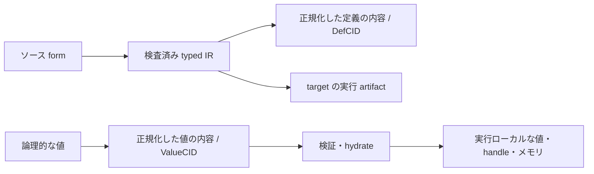

# Kotoba の物理的コスト、IPLD、実行時の配置

状態: 2026年10月23日に確認した設計解説。[英語の正本](physical-model-and-ipld.md)。
現在の契約をどう捉えるかを記した文書であり、新しい性能測定や runtime の実行保証ではない。
[日英の blog 原稿](../../site/physical-model-article.edn)。

Kotoba は、コード・値・状態を不変な内容として識別し、ストレージ・ネットワーク・
実行ホストをまたいで共有・検証することを重視する。物理的には、演算だけでなく、
データの移動・保存・再利用・検証のコストを意識した設計である。
この設計上の重心を、特定の装置で最速・最適と実証済みという主張に広げない。

## どのような物理環境を扱う設計か

CUDA/GPU、Verilog/回路、C/CPU、SQL/宣言的な問い合わせという対応は直感として有用だが、
ハードウェアと計算モデルが混ざっており、言語を一つの装置だけに割り当てる分類ではない。
Kotoba の[ターゲット非依存の構成方針](../stack-architecture-target-neutral.ja.md)は、
計算の意味・identity・authority と、選んだ実行ターゲットを分ける。

| 物理的な事情 | 関連する設計 | 追加で確かめること |
|---|---|---|
| RAM・ストレージ・別プロセスでは、アドレスや寿命が異なる | 内容で識別し、実行用の表現を分ける | 解決・hydrate・保持のコスト |
| 同じ内容を何度も転送・保存すると資源を使う | 不変ブロックの共有・重複排除・キャッシュ | ブロック配置、命中率、実際に削減したバイト数 |
| 遠隔の取得先が、別の内容や不正な値を返す可能性がある | 正規化、ダイジェスト検証、型の境界 | 検証の費用とホストの正しい強制 |
| CPU と GPU では効率のよい配置が違う | 論理的な識別と IR・handle・連続バッファを分離する | target ごとの処理、コピー、実測スループット |

一台のマシンでも、保存、プロセス再起動、検査した依存定義の再利用は、時間やアドレス空間を
またぐ。これらの性質を使うために、必ず分散配置する必要はない。
CID があるだけで、取得・可用性・操作権限まで与えられるわけではない。

## IPLD は論理的なデータモデル

[IPLD Data Model](https://ipld.io/docs/data-model/)は、値と内容で識別するリンクを記述する。
[DAG-CBOR](https://ipld.io/specs/codecs/dag-cbor/spec/)などの codec がそれをバイト列に写す。
CPU のポインタ配置や、実行中の GPU バッファの配置を規定するものではない。

Kotoba の[コード識別](../../lang/code-identity.edn)は、検査した typed KIR、interface、effect、
依存定義、version を持つ契約から導く。[値の codec](../../lang/value-codec.edn)は、
正規化した値のバイト列を識別する。生のソース form や一時的なコンパイラのノードが、
そのまますべて個別の永続ブロックや CID になるわけではない。

この区別は **form** という語にも必要である。確認した Amu の `kotoba.form` は、
`tag`、スカラーの内容、`kids`、`span`、`data` を持つ型付き AST レコードである。
子はソースの順に並び、map は key と value を交互に保持する。
この一時的な表現と、検査した定義や保存する値の canonical 表現を区別する。

これは表現の対応図であり、全コンパイラノードが保存を経由することや、
すべての target で全経路を実装済みという意味ではない。

## CID・Handle・Capability の役割

[実行時の識別契約](../adr/ADR-kotoba-cid-handle-cap-runtime.md)は、次を分ける。

- **ValueCID**: 物理的な場所に依存しない、不変の論理的な識別。
- **Handle**: その実行内で値を参照する、制限されたローカルな参照。
- **Capability**: 具体的な操作の権限。CID や Handle から導出しない。

契約上は、内容を解決・intern してローカルな表現に結び付ける。
普通の要素アクセスで、そのたびにハッシュや block の取得を行う必要はない。
[native の実行領域契約](../adr/ADR-native-execution-domains.md)も、同じ値表現・context・
予算を共有する、閉じた検査済み領域の内部では通常の型付き呼び出しを使う。
名前空間が違うだけでは直列化しない。実際の永続化・通信・provider・権限の境界には
検査を残す。backend の採用・admission の検証状態は、
[native value-runtime の正本](../../lang/value-runtime-native.edn)で別に管理する。

## node と block の粒度が費用を変える

[一つの IPLD block に複数の node を格納できる](https://ipld.io/docs/data-model/node/#nodes-vs-blocks)。
node は、一つの保存オブジェクト、一つの CID、一回のネットワーク要求と同じ単位ではない。
小さい再利用可能な block は必要な部分の取得や共有に向く一方、リンク・ハッシュ・lookup の
回数を増やす。大きな block はその負担を減らせる一方、不要な内容まで読む・転送する場合がある。
適切な粒度はアクセスと更新のパターンによって異なり、内容アドレスだけでは決まらない。
[内容アドレスの利点](https://ipld.io/docs/motivation/benefits-of-content-addressing/)を
実際の削減につなげるには、配置と実装が必要である。

計算結果の再利用には別の条件もある。[typed-eval のキャッシュ契約](../../lang/typed-eval.edn)は、
pure な結果を AdmissionCID と入力 ValueCID 群で識別し、実行条件を束縛する。
artifact の再利用ではコンパイラ・target・ABI の契約も守る。
外部 effect の実行を、以前の結果を返すことで置き換えてはならない。

## 大量の数値計算には別の配置を使う

IPLD による識別は、数値計算の内側ループで内容アドレス付きオブジェクトのグラフを
たどることを要求しない。密な列や tensor は、SIMD・GPU kernel に適した連続バッファを使い、
論理的な識別、descriptor、所有権を必要な境界で扱える。

[product defaults](../../lang/product-defaults.edn)には、Arrow・Wasm SIMD・GPU バッファの
部分的な実装が記録されている。同時に、ネットワーク入力、展開、GPU upload、永続更新で
生じるコピーを明記する。特定の kernel とホストでの測定を、全データ型・装置・アプリの
実行保証に広げない。この文書は新しいベンチマーク、自動並列化、全面的な zero-copy の
主張を追加するものではない。

評価では kernel のスループットに加え、処理全体の時間、転送・コピーしたバイト数、
取得・再利用した block、encode・decode・hash の仕事量、回避した再計算を測る。
workload、cold/warm cache、target、ホスト、所有権の移動、方針を明記し、
転送削減に伴う検証・配置の追加費用も含める。

## 根拠と関連文書

言語契約の確認時点は `kotoba-lang/kotoba-lang@1e535060ddfd989fd4866a44b38eea440e03ee67`。
[Amu の固定した form 実装](https://github.com/kotoba-lang/amu/blob/74ca4aa68ee31c1fdc160b69059a8081ceb4da1f/src/kotoba/form.kotoba#L1-L6)は、
未コミット変更と分けて確認した。これらは selfhost/native の全実行経路や本番サービスを
検証済みという証拠ではない。日付つきの解説より、各所有者の現在の契約を優先する。

意味解析の限界と、資源による中断・正常終了の違いは
[計算可能性と安全性](computability-and-safety.ja.md)を参照。
