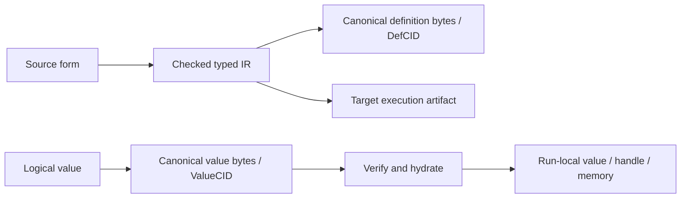

# Physical costs, IPLD, and execution layout in Kotoba

Status: explanatory design note, reviewed 23 October 2026. This is an
interpretation of the current contracts, not a new performance result or runtime
qualification. [日本語](physical-model-and-ipld.ja.md).
[Blog source](../../site/physical-model-article.edn).

Kotoba's design emphasizes immutable code, values and state that can be
identified, shared and verified across storage, networks and execution hosts.
Its physical concerns therefore include data movement, persistence, reuse and
verification as well as arithmetic. This is a design emphasis, not evidence of
optimal performance on any particular device.

## What physical environment does the design address?

Comparisons such as CUDA/GPU, Verilog/circuits, C/CPU and SQL/declarative queries
are useful intuitions, but mix hardware and computation models. They are not
exclusive assignments of a language to one device. Kotoba's
[target-neutral architecture](../stack-architecture-target-neutral.ja.md)
separates computation meaning, identity and authority from the selected target.

| Physical constraint | Relevant design choice | What still needs evidence |
|---|---|---|
| RAM, storage and other processes have different addresses and lifetimes | Portable content identities with local execution representations | Resolution, hydration and retention costs |
| Moving or storing identical content repeatedly consumes resources | Immutable blocks can be shared, deduplicated and cached | Block layout, cache hit rate and actual bytes avoided |
| A remote source may return substituted or malformed content | Canonical encoding, digest verification and typed boundaries | Actual validation cost and correct host enforcement |
| CPUs and GPUs favor different execution layouts | Keep logical identity separate from target IR, handles and packed buffers | Per-target workloads, copies and measured throughput |

These properties are useful on one machine too: saving an object, restarting a
process and reusing a checked dependency cross time and address-space boundaries
without requiring a distributed deployment. A CID neither fetches data by itself
nor guarantees availability or authorization.

## IPLD is a logical data model

The [IPLD Data Model](https://ipld.io/docs/data-model/) describes values and
content-addressed links. A codec such as
[DAG-CBOR](https://ipld.io/specs/codecs/dag-cbor/spec/) maps that model to bytes.
Neither specifies the CPU pointer layout or GPU buffer layout of a running
program.

In Kotoba, [code identity](../../lang/code-identity.edn) is derived from checked
typed KIR, interfaces, effects, dependencies and versioned contracts. The
[value codec](../../lang/value-codec.edn) identifies canonical value bytes.
Raw source forms and temporary compiler nodes are not thereby all separately
persisted, content-addressed blocks.

The distinction matters for the word **form**. At the inspected Amu revision,
`kotoba.form` is a typed AST record with `tag`, scalar payloads, `kids`, `span`
and `data`. Its children retain source order; maps keep alternating keys and
values. This transient compiler representation is different from the canonical
representation used to identify a checked definition or a persisted value.

This is a representation diagram, not a claim that every compiler node passes
through storage or that every target already implements every path.

## CID, Handle and Capability have separate roles

The [runtime identity contract](../adr/ADR-kotoba-cid-handle-cap-runtime.md)
defines:

- **ValueCID:** immutable logical identity, independent of physical location.
- **Handle:** a bounded execution-local reference to the value.
- **Capability:** authority for a concrete operation, not derived from either.

The contract resolves or interns content once into a local representation;
ordinary projections need not hash or fetch a block each time. The
[native execution-domain contract](../adr/ADR-native-execution-domains.md)
also permits ordinary typed calls inside a closed checked domain with a shared
representation, context and budget. Namespace boundaries alone do not require
serialization. Actual persistence, wire, provider and authority boundaries keep
their checks. Backend adoption and admission remain separately qualified by
the [native value-runtime authority](../../lang/value-runtime-native.edn).

## Node and block granularity change the cost

An [IPLD block may contain several nodes](https://ipld.io/docs/data-model/node/#nodes-vs-blocks).
A node is not necessarily one stored object, one CID or one network request.
Smaller reusable blocks can improve selective retrieval and reuse, while adding
links, hashes and lookups. Larger blocks can reduce such overhead but may
require reading and transferring unrelated content. The right granularity
depends on access and update patterns; content addressing alone does not choose
it. [Content addressing benefits](https://ipld.io/docs/motivation/benefits-of-content-addressing/)
are opportunities that the layout and implementation must realize.

Computation reuse has additional conditions. The
[typed-eval cache contract](../../lang/typed-eval.edn) keys a pure result by
AdmissionCID and input ValueCIDs, binding the relevant execution conditions.
Artifact reuse must also respect its compiler, target and ABI contracts.
An earlier result must never substitute for performing an external effect.

## Bulk numeric work needs its own layout

IPLD identity does not require inner numeric loops to traverse a graph of
content-addressed objects. Dense columns and tensors can use contiguous buffers
appropriate for SIMD or GPU kernels, with their logical identity, descriptor
and ownership handled at the relevant boundary.

The [product defaults](../../lang/product-defaults.edn) record partial Arrow,
Wasm SIMD and GPU buffer paths. They also name copies at network ingress,
decompression, GPU upload and persistent updates. The recorded kernel-and-host
measurements do not qualify all data types, devices or applications. This note
adds no benchmark and does not claim automatic parallelization or universal
zero-copy execution.

Evaluate this design with end-to-end latency, transferred and copied bytes,
blocks fetched/reused, encode/decode/hash work and recomputation avoided, in
addition to kernel throughput. State the workload, cold/warm cache conditions,
target, host, ownership transfers and policy. A lower transfer cost is useful
only after accounting for any additional verification or layout work.

## Evidence and related reading

Language contracts were inspected at
`kotoba-lang/kotoba-lang@1e535060ddfd989fd4866a44b38eea440e03ee67`.
[Amu's committed form representation](https://github.com/kotoba-lang/amu/blob/74ca4aa68ee31c1fdc160b69059a8081ceb4da1f/src/kotoba/form.kotoba#L1-L6)
was read independently of uncommitted work. These source observations do not
qualify the complete selfhost/native execution closure or a deployed service.
The current owner contracts take precedence over this dated interpretation.

For the limits of semantic analysis and the distinction between resource
interruption and successful completion, see
[computability and safety](computability-and-safety.md).
