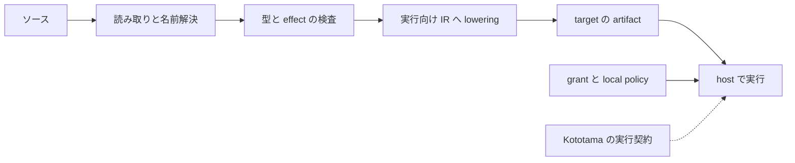

# 01 最初の 42 と全体像

[English](01-first-program.md) | **日本語**

最初の到達点は、自分で読めるソースが native compiler を通って `42` を返すこと。
この一周を知ると、以後の各工程が何を受け取り、何を返すか理解しやすい。

## 動かす例

[00-literal.kotoba](examples/00-literal.kotoba) は次の全文である。

```clojure
(ns lesson.literal (:export [main]))
(defn main [] :i64 42)
```

`ns` は名前空間と公開する関数を宣言する。`main` は引数なしで、符号付き64ビット整数を返す。
`:i64` は戻り値の型である。`check` で検査し、`run` で実行すると `42` が標準出力に出る。
ここで出る `42` は OS の exit code ではない。成功した Mac CLI の exit code は `0` である。

## 各部品の仕事

| 名前 | 仕事 |
|---|---|
| Kotoba | 式・値・型・effect など、プログラムの意味を定める言語 |
| Amu | ソースを読み、検査し、lowering とコード生成、プロジェクトリンクを行う |
| Kototama | 何を入力に実行し、状態・結果・権限・資源・receipt をどう扱うかという VM 契約 |
| host と provider | 実行機構と、許されたファイル・通信などの具体的な操作を提供する |
| grant | 操作を許すか判断する側。コンパイラが新しい権限を作ることはない |
| AiueOS | Kotoba Lisp machine の OS 方向。OS を使わない host も存在し得る |

Amu の特徴は Lisp のデータとして読めるプログラム、検査と authority の明示、内容による定義の識別、
複数 target、native selfhost の取り組みをつなぐ点にある。Wasm は target の一つであり VM の定義ではない。



この図の箱は責任の区分である。全 target が同じ内部データ構造や全 VM 機能を持つわけではない。
Mac の公開 CLI は現在単一ソースの `main [] :i64` を扱う bounded な入口なので、最初の教材もその範囲に合わせる。

## 読むソース

[Amu README](https://github.com/kotoba-lang/amu/blob/a4c16e7c47005d2235dc48d3f69569773a1606e7/README.md) と
[native 公開入口](https://github.com/kotoba-lang/amu/blob/a4c16e7c47005d2235dc48d3f69569773a1606e7/docs/native-public-entry.md)を読む。
全ソースを読み切る必要はない。入力、戻り値、host と guest の権限の違いに印を付けよう。

## 小課題と解説

コピーした例の `42` を `43` に変更し、検査と実行を行う。予想する出力は `43`。
これは内容が変わったときに結果も変わるという最初の観測である。
この観測だけでは、DefCID の変化や最適化の有無は分からない。それぞれ後の章で別の対象を観測する。

[目次](README.ja.md) · [次へ ソースと form](02-forms.ja.md)
