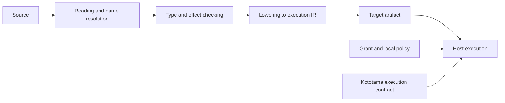

# 01 The first 42 and the big picture

**English** | [日本語](01-first-program.ja.md)

The first goal is to pass source you can read through a native compiler and obtain `42`. Completing this small loop makes the inputs and outputs of later stages easier to understand.

## Run the example

[00-literal.kotoba](examples/00-literal.kotoba) contains this complete program:

```clojure
(ns lesson.literal (:export [main]))
(defn main [] :i64 42)
```

`ns` declares the namespace and exported function. `main` takes no arguments and returns a signed 64-bit integer; `:i64` is its result type. Check it with `check` and execute it with `run`. The `42` on standard output is the result, not the OS exit code: the successful Mac CLI exits with code `0`.

## Responsibilities

| Component | Responsibility |
|---|---|
| Kotoba | Defines expressions, values, types, effects, and program meaning |
| Amu | Reads and checks source, lowers it, generates code, and links projects |
| Kototama | Defines the VM contract for execution inputs, state, outcomes, authority, resources, and receipts |
| Hosts and providers | Supply execution mechanisms and concrete authorized operations, such as file or network access |
| grant | Decides permission; the compiler cannot create new authority |
| AiueOS | The OS direction for the Kotoba Lisp machine; other hosts need not use that OS |

Amu connects Lisp's programs-as-data approach with explicit checking and authority, content-addressed definition identity, multiple targets, and native selfhosting. Wasm is one target, not the definition of the VM.



The boxes describe responsibilities, not one data structure shared by every target or proof of complete VM support. The public Mac CLI is a bounded, single-source entry for `main [] :i64`, so the initial examples stay within that scope.

## Read the source

Read the [Amu README](https://github.com/kotoba-lang/amu/blob/a4c16e7c47005d2235dc48d3f69569773a1606e7/README.md) and [native public entry](https://github.com/kotoba-lang/amu/blob/a4c16e7c47005d2235dc48d3f69569773a1606e7/docs/native-public-entry.md). Focus on inputs, results, and the distinction between host and guest authority rather than trying to read the entire compiler at once.

## Exercise and answer

Change `42` to `43` in a copy and check and run it. The expected result is `43`. This observes a source change affecting a result; it does not observe a DefCID change or establish which optimizations ran. Later chapters examine those separately.

[Contents](README.md) · [Next: source and forms](02-forms.md)
