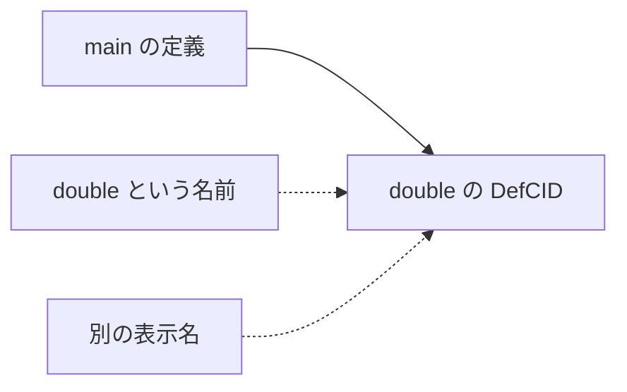

# 06 Unison に通じる定義の識別

[English](06-definition-identity.md) | **日本語**

[Unison の中心的な考え](https://www.unison-lang.org/docs/the-big-idea/)は、定義を内容から識別し、
人が使う名前をその識別から分けることである。
Kotoba はこの考えを、検査済み定義の CID と IPLD に接続する。
Unison の構文や codebase manager をそのまま採用するという意味ではない。

## 名前を変えても参照関係を保つ

次の二つは説明用の関数本体である。

```clojure
(fn [x] (+ x 1))
(fn [y] (+ y 1))
```

`x` と `y` は、どちらも自分の引数を指す。α 正規化はこの束縛関係を保ちながら名前の違いを取り除く。
概念的には「引数0を読む」のような表現になる。名前の置換だけで、自由変数や別の束縛まで同じにしてはいけない。
空白や局所名は identity の偶然の差にならない一方、参照先や型が変われば内容は変わる。

## Definition CID の六つの入力

現在の payload-v2 の契約は次を seal する。

1. 正規化した typed KIR。
2. language profile version。
3. desugar contract version。
4. semantic な名前で表す effect row。
5. interface。
6. 直接参照する定義の CID 群。

検査前の文字列を hash する方式と違い、「何を呼び、何を返し、何を行い得るか」が identity に入る。
effectful な関数にも CID はある。effect が空かどうかも識別されるが、その CID は effect を実行する許可ではない。
またこれは任意の二つのプログラムの意味的同値性を決定する仕組みではない。
`(+ x x)` と `(* x 2)` が必ず同じ CID になる、という約束もない。

## 依存を名前から CID へ

`main` が `double` を呼ぶとき、保存する定義の依存は名前だけでなく、その `double` の定義 CID を指す。
`double` の意味が変わればその CID が変わり、それを参照する `main` の identity にも影響する。
名前空間は人が読むための mapping として扱える。



互いに呼び合う関数は、片方の hash がないともう片方を hash できない。
そこで strongly connected component（SCC、強連結成分）として一群を正規化する。
IPLD の block link 自体を循環させるのではなく、群の内部参照を canonical な member index で表す。
native 候補の `scc-v1` は最大8 member という境界を持つ。大きな call graph を分割できることと、
大きな再帰群の canonical identity を認めることは別である。

## native 実装の到達範囲

言語側の識別契約・参照実装と、採用された native compile path を分ける。
Amu の native `definition-cids` producer／codec／SCC は、確認した revision では standalone 候補で、
通常の `MANIFEST`／`FULL-MANIFEST` に入っていない。
公開 Mac `check/run` の成功から、その経路が毎回 canonical DefCID を発行したとは言えない。
DefCID 単位の全 compiler の永続 object reuse も、この性質だけで完成しない。

## 読む契約とソース

[code identity](../../../lang/code-identity.edn)、
[native definition-cids の範囲](https://github.com/kotoba-lang/amu/blob/a4c16e7c47005d2235dc48d3f69569773a1606e7/docs/definition-cids-native.md)、
[SCC の候補実装](https://github.com/kotoba-lang/amu/blob/a4c16e7c47005d2235dc48d3f69569773a1606e7/seed/06-definition-groups.kotoba)。

## 小課題と解説

依存定義は同じまま、compiler の最適化設定だけを変えたら何が変わるだろうか。
意味の契約が同じなら DefCID は同じでよいが、build key と artifact bytes は変わり得る。
「同じ定義だから以前の機械語を無条件に使う」は安全な cache key ではない。

[前へ](05-ipld.ja.md) · [目次](README.ja.md) · [次へ effects と権限](07-effects-and-authority.ja.md)
