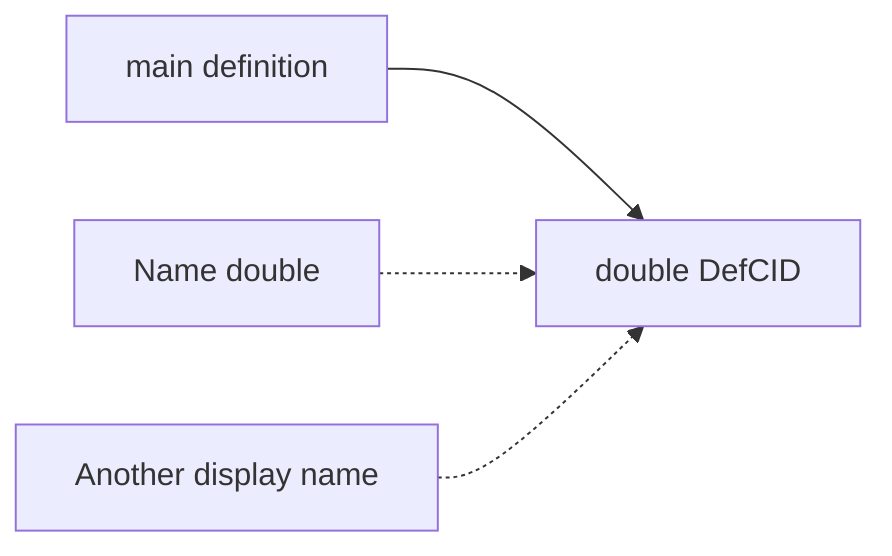

# 06 Unison-inspired definition identity

**English** | [日本語](06-definition-identity.ja.md)

[Unison's central idea](https://www.unison-lang.org/docs/the-big-idea/) is to identify definitions by content and keep human-readable names separate. Kotoba connects this idea to checked definition CIDs and IPLD. It does not adopt Unison's syntax or codebase manager wholesale.

## Rename while preserving references

These are explanatory function expressions:

```clojure
(fn [x] (+ x 1))
(fn [y] (+ y 1))
```

Both `x` and `y` refer to their own argument. Alpha normalization removes the spelling difference while preserving the binding relationship, conceptually using a reference such as argument 0. It must not confuse free variables or distinct bindings. Whitespace and local names need not create accidental identity differences; changing a referenced definition or type changes the content.

## Six inputs to a Definition CID

The current payload-v2 contract seals:

1. Normalized typed KIR.
2. The language profile version.
3. The desugar contract version.
4. An effect row expressed using semantic operation names.
5. The interface.
6. Direct definition dependency CIDs.

Unlike hashing unchecked text, this binds what a definition calls, returns, and may do. Effectful definitions also have CIDs; the effect row distinguishes them without granting permission to perform those effects. This is not a decision procedure for arbitrary program equivalence: `(+ x x)` and `(* x 2)` are not guaranteed to share a CID.

## Replace dependency names with CIDs

When `main` calls `double`, the stored dependency points to the particular definition CID, not merely the name. A change to `double`'s meaning changes its CID and affects the identity of a `main` that seals that dependency. Namespaces can remain human-readable mappings.



Mutually recursive definitions cannot wait for one another's individual hashes. A strongly connected component, or SCC, is normalized as a group. Internal references become canonical member indices rather than cyclic IPLD block links. The native `scc-v1` candidate bounds groups to eight members. Partitioning a large call graph is separate from admitting canonical identity for a large recursive group.

## Native implementation scope

Distinguish the language identity contract and reference implementation from the adopted native compile path. At the pinned revision, the native `definition-cids` producer, codec, and SCC path are standalone candidates outside the ordinary `MANIFEST` and `FULL-MANIFEST`. A successful public Mac `check/run` does not establish that it minted a canonical DefCID. Persistent object reuse across the whole compiler also needs more than identity alone.

## Read the contracts and source

Read [code identity](../../../lang/code-identity.edn), the [native definition-cids scope](https://github.com/kotoba-lang/amu/blob/a4c16e7c47005d2235dc48d3f69569773a1606e7/docs/definition-cids-native.md), and the [SCC candidate](https://github.com/kotoba-lang/amu/blob/a4c16e7c47005d2235dc48d3f69569773a1606e7/seed/06-definition-groups.kotoba).

## Exercise and answer

What changes if only compiler optimization settings change? Under the same semantic contract, the DefCID can remain the same while the build key and artifact bytes change. Reusing old machine code merely because the definition is unchanged is not a sufficient cache policy.

[Previous](05-ipld.md) · [Contents](README.md) · [Next: effects and authority](07-effects-and-authority.md)
