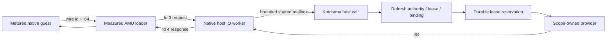

# Native per-call lease transport v2 — integration

The POSIX Node native host now supports an explicit synchronous unary i64
lease transport. Kototama authenticates admission, derives scopes from leases,
and durably reserves one use before every provider effect. The native loader
only frames calls; it has no lease policy or local-provider fallback in this mode.

Launcher composition supplies `mechanisms` a sixth argument, a vector of exact
`{:id integer :scope [capability-cid resource-cid purpose]}` bindings. Their
canonical content is included in the interface CID and thereby in the authenticated
profile binding and intent. The signed native artifact's typed imports and effects
must match these IDs exactly. The guest never receives scope descriptors, callbacks,
trust keys, a ledger, or serialized authority. Pure native composition retains the
five-argument API and its existing interface CID domain.

Accepted programs have a metered zero-argument `main` returning i64, scalar
helpers, a closed arithmetic/control/call operation set, and unary typed i64
imports. The explicit v2 binding treats numeric IDs as artifact-local import slots
within the existing native wire width (1–255); legacy provider/catalog semantics
remain on the legacy mode. Every admitted scope must match the launcher bindings before spawn.
C's legacy cap-call slot carries this scalar native ABI; generic source cap-call
and aggregate typed calls are refused by the v2 adapter. IDs retain the native
wire representation and do not change the language capability catalog.

The worker owns process IO, bounded ASCII framing, and an independent hard
deadline. Host policy and provider callbacks execute on the caller thread.
Requests have strictly increasing sequence numbers; only one is outstanding.
Frames are at most 96 bytes, at most 4096 calls, output at most 64 KiB,
and wall time at most 5 seconds. A failure kills the POSIX process group,
including the supervisor's guest child. A late reply cannot overwrite terminal
state. Providers are trusted bounded synchronous mechanisms: killing the child
does not preempt an already-running host callback or reverse its external effect.

The transport mode is explicit `KEXE_LEASE_TRANSPORT=i64-v2`, with inherited
request fd 3 and response fd 4. Missing descriptors or malformed mode fail closed.
The executor constructs this environment, without ambient fs/spawn/network grants.
The loader bypasses its legacy native provider brokers in this mode; typed aggregate
provider slots trap. Legacy invocation and Windows execution remain separate.

The acceptance gate executes actual compiled and signed native guests through a
reproduced and measured loader. It checks a private append and result 42, signed
completion, exhaustion, revocation, partial effect followed by trap, invalid provider
result, replay after reopening the durable ledger, scope substitution, and closed
imports. Mechanism faults test framing, ordering, output and deadlines separately.
Public loader SHA and source-bound parser-fuzz pin advance together; x64/ARM64
coverage floors and the separately preserved trusted-bootstrap loader are retained.

Reservations and external commits are not atomic; partial/no effects can burn a
use. Receipts attest observed completion, not external commit/finality. Node host
qualification is not Q9, selfhost, distributed quota or production-finality evidence.
General values, Windows transport, async/cancellation contracts, external idempotency
and effect receipts, and large native envelope raw-block binding remain future units.

Verified evidence: macOS ARM64 and Linux x64/ARM64 native provider 8 tests / 43 assertions; transport 4 / 22 on both Linux ISAs; host 8 / 174, native host 10 / 83, Wasm/Script provider 7 / 80. Public/trusted source-bound Linux fuzz retains both ISA floors. Native owner Actions remains disabled; no repository CI settings were changed.
