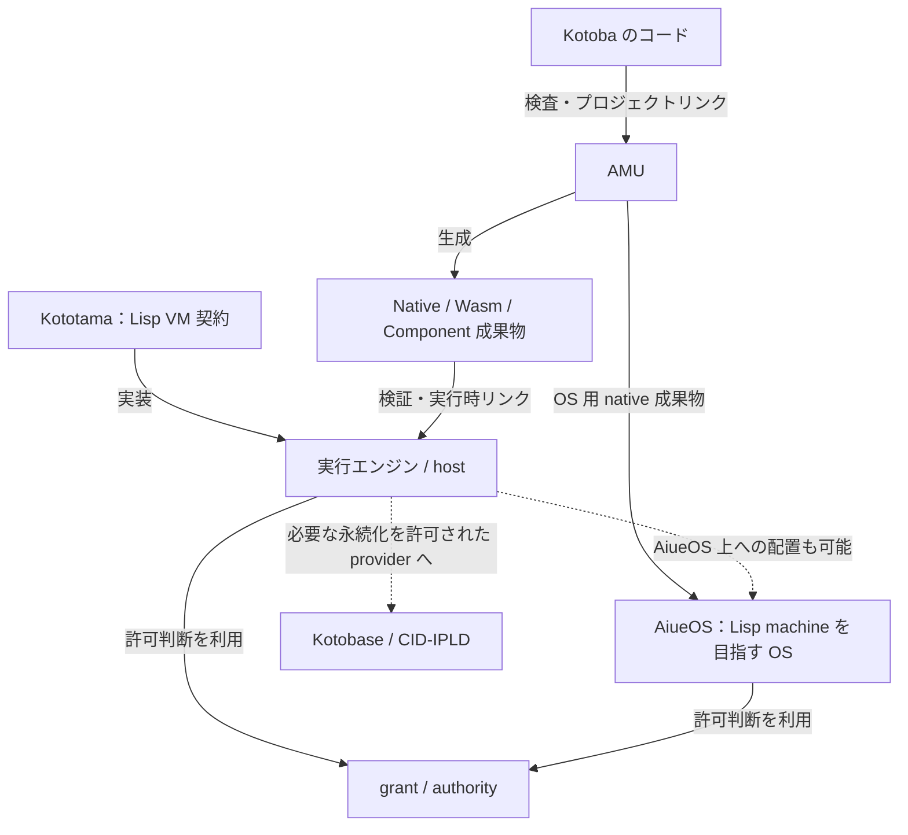
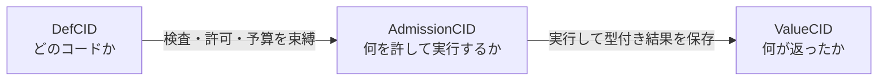
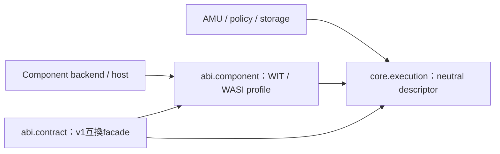

# Kotoba：現代の Lisp machine を組み立てる

構成をさらに整える[ターゲット非依存・分散アーキテクチャの構成方針](../stack-architecture-target-neutral.ja.md)：
WasmはAMUの出力先の一つ。中心に言語・VM・権限・identityの契約を置き、
WIT等はtarget profile、IPFS等は配布、inga等は宣言したdomainの合意として接続する。
実行targetと分散方式を独立に選び、各組合せのqualificationを明示する。

## 1. 全体像

**AiueOS は、Kotoba による現代の Lisp machine を目指す OS。**
Kototama はその計算モデルを担う Lisp VM 契約、AMU はコンパイラです。
Kototama には hosted engine もあり、すべての実行が AiueOS を必要とするわけではありません。

| 名前 | 役割 |
|---|---|
| Kotoba / kotoba-lang | コードを扱う言語・開発環境 / 言語仕様の正本 |
| AMU | 型・効果を検査し、成果物を生成する。プロジェクトリンクを担当 |
| Kototama | 閉じた S 式、状態遷移、予算、実行記録を定義する VM 契約 |
| runtime host | 契約を実装し、検証・実行時リンク・実行を担当 |
| grant / authority | 許可判断 / 権限範囲と委譲のモデル |
| AiueOS | 起動・メモリ・プロセス・デバイスを担い、許可判断を強制する OS |
| Kotobase | データ・状態・実行記録の永続化基盤 |
| sahai | 汎用の配置・lease・fencing。Murakumo は推論 fleet 自身の制御面を持つ |

## 2. 言語からコンピュータへ

矢印はラベルの関係を表します。これはソース依存グラフではありません。

## 3. Lisp machine としての新しさ

コードを値・構造として扱う Lisp の考え方を、型付き効果・能力ベースの権限・
内容アドレスと組み合わせます。実行対象、実行許可、結果を別々に識別します。

CID が分かることは実行許可ではありません。provider が無ければ実行を拒否します。
Kototama の admission core は Kotoba の閉じた述語と capability chain を使い、
Datalog と Biscuit は core の外側の query / adapter です。

## 4. 実装状況の伝え方

「現代の Lisp machine を目指す」は構成・方向を表す説明です。
統合 REPL・editor・debugger、稼働中の任意変更、heap・継続を含む image 復元、
selfhost、C-free 本番経路、実機 qualification はそれぞれ証拠を示します。
Codebase の保存を実行中 machine image の保存と呼びません。
QEMU・hosted・hybrid の成功を C-free 実機の完了と読み替えません。

## 5. 中立契約とtarget profileの実装

neutral入口は17 export・source import 0。Component入口は39 export、互換入口は既存46 exportを維持。
新しいv2 identity/leaseはprofile bindingのCIDを参照し、既存v1のwire・CID・署名は変えない。
AMUのnative既定経路を維持し、v2 は明示 entrypoint として追加した。authority が invocation と intent/lease を発行し、host が実 artifact/runtime の binding と署名を検証して durable ledger に登録する。実行後に outcome・receipt・completed identity を生成する。

23 target の閉じた契約と admission fixture を検証し、native、Node Core Wasm、restricted Script、bounded EVM、Wasmtime Component の純粋な結果 42 を確認した。全 host の qualification、native／汎用Script provider、async、Q9 の完了は主張しない。

[移行単位の実装・検証](../execution-v2-migration.md)

## 6. target profile は実行する単位で揃える

AMU の target と、実行 host の loader・executor・grammar・fuel・receipt を一式で検査する。
neutral 契約へ物理 hash や OS の挙動を押し込まない。
単一ファイル grant はそのファイルだけを許可し、親ディレクトリへ権限を広げない。
loader source が変われば、その profile の runtime identity と trust を更新する。
native・Script・Wasm の成功と拒否はそれぞれ実行成果物で示す。

[実装と検証のレポート](../stack-architecture-target-neutral-report.md)

## 7. 説明とリファクターの正本

[全体仕様と依存図](../stack-architecture.md) ·
[機械可読構成 spec](../../lang/stack-architecture.edn) ·
[全体リファクター手順](../stack-refactor-procedure.md)

## 8. capability の権限を実際の呼出しまで結ぶ

Node Wasm／Script の明示 v3 artifact は、typed import と
capability・resource・purpose の scope を固定する。authority が intent と
lease を署名し、Kototama が導いた scope と一致してからリンクする。
呼出しごとに use を durable に予約し、provider が実 resource を操作する。
結果・trap を観測して、新しい完了 identity と署名 receipt を作る。

実 guest の provider-owned file への追記 1 回、結果 42、use 枯渇・失効・
trap・再起動後の replay 拒否を Node Wasm／Script で検証する。
これは同期 scalar profile の証拠であり、汎用 JS sandbox、native effect
transport、async、分散本番、Q9 を一括で qualify するものではない。
